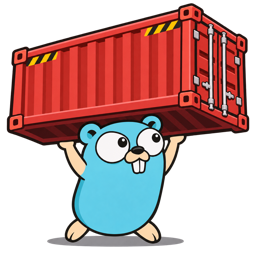

#  `go-container`

`go-container` is a Go client for [Apple container][1].

With this library, a Go program can do the same work as the `container` command line tool: pull images, create and run containers, and manage networks, volumes, and kernels.
The library communicates with the API server, `com.apple.container.apiserver`, using the XPC protocol. It is written in pure Go and the core has no dependencies.

## Installation

To avoid forcing consumers to take unwanted dependencies, there are two separate Go modules:

| Module                                       | Purpose                                                                                                              |
|----------------------------------------------|----------------------------------------------------------------------------------------------------------------------|
| `github.com/jen20/go-container`              | The core, dependency-free `container` package for the API server and the image service.                              |
| `github.com/jen20/go-container/systemconfig` | An independent loader for the container system's TOML configuration files. Depends on the `BurntSushi/toml` library. |

## Example

This program runs a command in an Alpine container, prints the output, and removes the container.

```go
package main

import (
	"context"
	"fmt"
	"log"
	"os"

	"github.com/jen20/go-container"
	"github.com/jen20/go-container/systemconfig"
)

func main() {
	ctx := context.Background()

	c := container.NewClient(container.WithConfigFileLoader(systemconfig.Load))
	defer c.Close()

	health, err := c.Ping(ctx)
	if err != nil {
		log.Fatalf("API server is not available: %v", err)
	}
	fmt.Println("API server version:", health.APIServerVersion)

	const id = "hello"
	_, err = c.CreateContainerFromImage(ctx, id, "alpine:3.22", &container.ImageContainerOptions{
		Entrypoint: "/bin/echo",
		Arguments:  []string{"hello from alpine"},
	})
	if err != nil {
		log.Fatal(err)
	}
	defer c.DeleteContainer(ctx, id, true)

	proc, err := c.BootstrapContainer(ctx, id, container.Stdio{Stdout: os.Stdout}, nil)
	if err != nil {
		log.Fatal(err)
	}
	status, err := proc.Run(ctx)
	if err != nil {
		log.Fatal(err)
	}
	fmt.Println("exit code:", status.Code)
}
```

`CreateContainerFromImage` does the same steps as `container run` before the container starts.
If the image is not local, it pulls the image.
Then it unpacks the image and attaches the container to the built-in network.
If you need more control, call `ConfigFromImage`, change the configuration, and pass it to `CreateContainer`.

## Features

The `container` package covers these areas of the API:

- Containers: create, bootstrap, stop, kill, delete, logs, stats, export, and copy of files in and out.
- Processes: run more processes in a running container, wait for exit, send signals, and resize the terminal.
- Images: list, pull, push, tag, delete, save, load, unpack, and read the OCI index, manifest, and configuration.
- Content store: read, ingest, and delete blobs.
- Networks, volumes, and kernels.
- Disk usage for the system, containers, volumes, and images.

Use `go doc` for the full API:

```sh
go doc -all github.com/jen20/go-container
```

## Connections

A `Client` is safe for concurrent use.
It connects on the first request, not in `NewClient`.
If the API server restarts, the request that finds the old connection gone fails.
The next request connects again.

If the context has no earlier deadline, most requests time out after `container.DefaultTimeout` (60 seconds).
Requests that wait for a process to exit have no timeout and use only the context.

## Errors

An error from the API server is a `*container.Error` with a `Code` and a `Message`.
You can compare an error with the sentinel errors through `errors.Is`:

```go
_, err := c.GetContainer(ctx, "missing")
if errors.Is(err, container.ErrNotFound) {
// The container does not exist.
}
```

## Configuration

By default, `container.NewClient` uses the built-in values returned by `container.DefaultSystemConfig` without reading any configuration files.
To use the same configuration files as the `container` command line tool, create the client with `container.NewClient(container.WithConfigFileLoader(systemconfig.Load))`.

The client asks the API server for the application and installation roots.
The loader reads the TOML files at those roots.
The client applies user settings ahead of system settings and fills in missing values from `container.DefaultSystemConfig`.

You can pass these options to either constructor:

- `container.WithConfig` uses the supplied configuration values.
- `container.WithConfigLoader` supplies a custom loader that returns a typed `container.SystemConfig`.
- `container.WithConfigFileLoader` supplies a file reader, such as `systemconfig.Load`.
  Pass file paths after the reader to choose the file explicitly, in precedence order.

## Development

The repository has a Nix development shell. To enter it, run `nix develop`.

To run the unit tests in both modules, run these commands:

```sh
go test ./...
(cd systemconfig && go test ./...)
```

The unit tests for the XPC codec compare the output with messages that the system `libxpc` sent.
These messages are in `internal/xpc/testdata/libxpc`.

The integration tests run against a real API server.
Start the container system first, then run the tests:

```sh
container system start
go test -tags integration -count=1 .
```

The integration tests create resources with names that start with `go-container-it-`, and remove them after each test.
If you set `GO_CONTAINER_TEST_VM=1`, the tests that boot a container VM also run:

```sh
GO_CONTAINER_TEST_VM=1 go test -tags integration -count=1 .
```

The GitHub Actions workflow runs the integration tests on each push to `main` and on each pull request.
GitHub's hosted macOS runners cannot start nested VMs, so the workflow skips the tests that boot a VM.

### Test environment variables

The package also has live tests.
A live test is a test inside the package that talks to the API server.
The live tests and the integration tests skip some tests unless you set these environment variables:

| Variable                  | Tests that it turns on                                                                                                      |
|---------------------------|-----------------------------------------------------------------------------------------------------------------------------|
| `GO_CONTAINER_TEST_LIVE`  | Live tests that use only read-only routes.                                                                                  |
| `GO_CONTAINER_TEST_WRITE` | Live tests that create and delete images, volumes, networks and containers. These tests also need `GO_CONTAINER_TEST_LIVE`. |
| `GO_CONTAINER_TEST_VM`    | Live tests and integration tests that boot a container VM. The live tests also need the two other variables.                |

To turn on a variable, set it to `1` or `true`. The `internal/testenv`
package reads the value with `strconv.ParseBool`. If a variable is not set,
or `strconv.ParseBool` does not read it as `true`, the variable is off.

Some live tests need `debian:trixie-slim` in the local image store. If the
image is not there, these tests skip. To run all the live tests, run these
commands:

```sh
container system start
container image pull debian:trixie-slim
GO_CONTAINER_TEST_LIVE=1 GO_CONTAINER_TEST_WRITE=1 GO_CONTAINER_TEST_VM=1 go test -count=1 .
```

## Releases

`CHANGELOG.md` lists the changes in each release.
When you change something that a user of the library can see, add a line to the `## Unreleased` section.
Use the subsections `New Features`, `Bug Fixes`, `Deprecated`, `Removed`, and `Security`, and leave out a subsection that has no changes.
Write a short summary for a user of the library.
For a breaking change, tell the reader what to change in their code.

To make a release, do these steps:

1. In `CHANGELOG.md`, change `## Unreleased` to `## <version> - <date>`, for example `## 0.1.0 - 2026-11-20`.
2. Above that section, add a new, empty `## Unreleased` section.
3. Merge the change to `main`.
4. On GitHub, open Actions, select the Release workflow, and click "Run workflow".
5. Type the version, for example `0.1.0`, and start the workflow.

Before you merge, you can run the same changelog check as the workflow.
The script prints the release notes for the version:

```sh
.github/scripts/release-notes.sh 0.1.0
```

The workflow tags the head of `main` with `v<version>` for `github.com/jen20/go-container`, and `systemconfig/v<version>` for `github.com/jen20/go-container/systemconfig`.
Then GoReleaser publishes the GitHub release, with the version's section of `CHANGELOG.md` as the release notes.
A version with a pre-release part, such as `0.2.0-rc.1`, makes a
GitHub pre-release.

The workflow stops if the version is not a semantic version, or if a tag for the version exists.
It also stops if `CHANGELOG.md` does not start with an `## Unreleased` section, followed by the version's section with a valid release date.

## License

`go-container` is published under the Apache License, Version 2.0. The full
text is in [LICENSE][2].

[1]: https://github.com/apple/container
[2]: LICENSE
